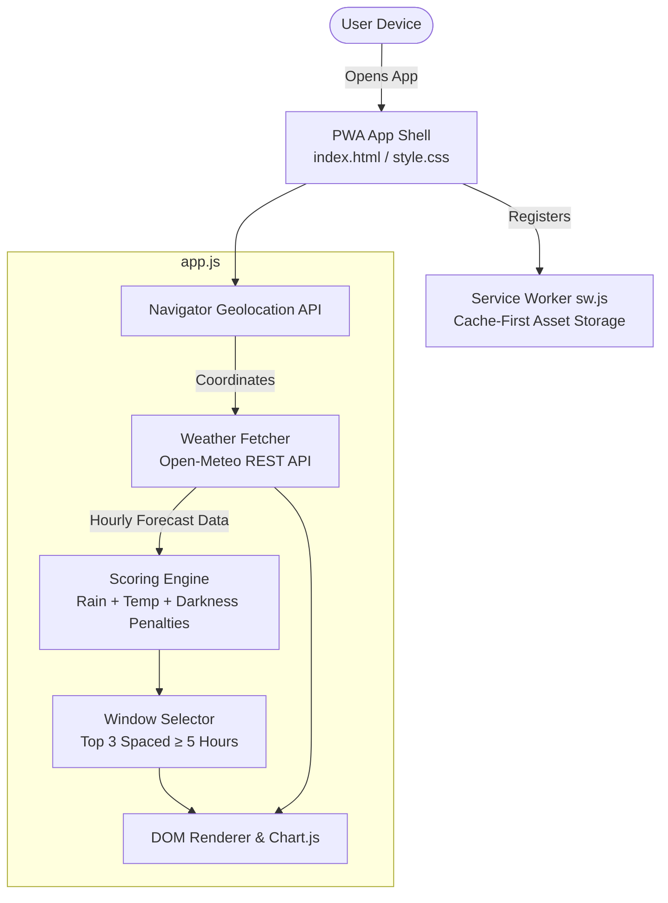

# When to Walk 🐕🌤️

> A lightweight Progressive Web App (PWA) designed to find the optimal times to walk your dog based on hourly precipitation, comfortable temperatures, and daylight.

**When to Walk** takes the guesswork out of dog walking. Using device geolocation and live meteorological forecasts from Open-Meteo, the app analyzes upcoming weather conditions and scores each hour to deliver top daily walking recommendations alongside an interactive precipitation forecast.

---

## 🚀 What the App Does

- **Automated Geolocation**: Detects user coordinates to provide localized forecast information immediately on launch.
- **Top 3 Recommended Windows 🏆**: Calculates a walking suitability score for each hour between 5:00 AM and 9:00 PM, recommending the three best windows spaced at least 5 hours apart across the day.
- **Hourly Precipitation Chart**: Visualizes rain probability over the next 24 hours using Chart.js, complete with a dynamic vertical indicator marking the current hour.
- **Sun & Day/Night Tracking**: Displays daily sunrise and sunset schedules and visually shades nighttime hours.
- **Unit Switching**: Easily toggle between Imperial (°F) and Metric (°C) units.
- **PWA & Offline Ready**: Installable as a standalone app on iOS and Android devices, with a service worker caching shell assets for instant load times.

---

## 🛠️ Tech Stack

| Technology | Role | Description |
| :--- | :--- | :--- |
| **HTML5 & CSS3** | Structure & Styling | Modern dark-theme UI with responsive card layouts, flexbox, and custom toggle switches. |
| **Vanilla JavaScript (ES6+)** | Application Logic | Clean, zero-framework client-side logic handling state, geolocation, weather scoring, and DOM updates. |
| **Chart.js** | Data Visualization | Renders the responsive 24-hour precipitation bar chart with a custom canvas plugin for the "Now" timeline mark. |
| **Open-Meteo API** | Weather Data | Free, open-source weather API providing hourly precipitation probability, 2m temperature, weather codes, and sunrise/sunset times without API keys. |
| **Service Worker & Manifest** | PWA Capabilities | Offline app-shell caching strategy (`sw.js`) and installable web app manifest (`manifest.json`). |

---

## 🏛️ Architecture & Data Flow



### Key Architectural Components

1. **State & Orchestration (`app.js`)**:
   - Manages location coordinates, imperial/metric unit state, and parsed forecast payloads.
   - Orchestrates the full lifecycle: Geolocation &rarr; API Fetch &rarr; Scoring &rarr; DOM/Chart updates.

2. **Scoring Algorithm (`calculateScore`)**:
   - Scores each daytime window (5:00 AM – 9:00 PM) based on three weighted factors:
     $$\text{Score} = (\text{Precipitation \%} \times 2) + |\text{Temp (°F)} - 60| + \text{Darkness Penalty (10)}$$
   - *Lower scores represent ideal walking conditions.*

3. **Window Distribution Filter**:
   - Avoids clustering recommendations by ensuring each of the Top 3 selected windows is spaced at least **5 hours apart**, then sorts the final picks chronologically.

4. **Service Worker Caching (`sw.js`)**:
   - Implements a cache-first strategy for static assets (`index.html`, `style.css`, `app.js`, `manifest.json`, icon) for instantaneous launch performance.

---

## 📂 Project Structure

```text
when-to-walk/
├── app.js          # Core application logic, API client, scoring algorithm & Chart.js setup
├── index.html      # Main application markup and PWA metadata
├── style.css       # Dark-theme design system, typography, and responsive styles
├── sw.js           # Service worker implementing asset caching and lifecycle management
├── manifest.json   # Web App Manifest for mobile installation
├── icon-512.png    # App launcher icon
├── .gitignore      # Git ignore configuration
└── README.md       # Project documentation
```

---

## 💻 Running Locally

Because the application utilizes a Service Worker (`sw.js`), it should be served over HTTP/HTTPS rather than opened via the `file://` protocol.

You can launch a simple local development server using any of the following:

```bash
# Using Python
python -m http.server 8000

# Using Node.js (npx)
npx serve .
```

Then open `http://localhost:8000` in your browser.
